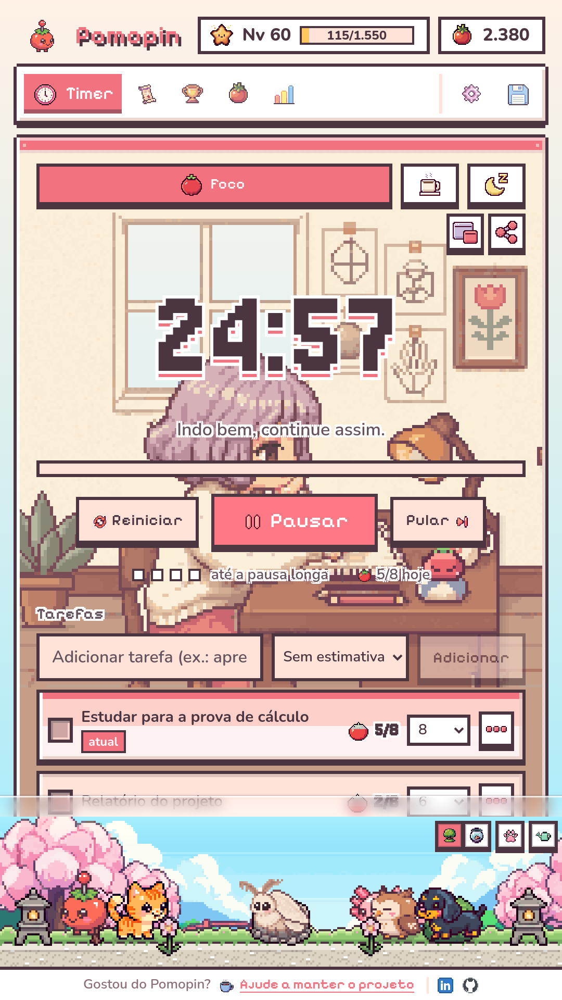
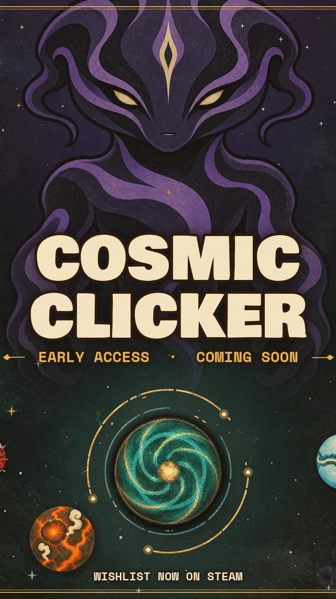
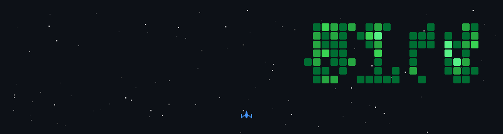

<!-- Banner -->

  

  

  
  
  

  <a href="README.md">🇧🇷 Português</a> · 🇺🇸 English

---

## 👋 About me

I'm a software engineer working with **Go** and **AWS** every day. In my spare time, I build and publish personal projects and take on freelance work.

---

## 💼 Experience

- 🏦 **Itaú Unibanco**: backend development with **Go** and **AWS** for critical systems, handling very high request volumes with top requirements for availability, performance and security.
- 🚀 **Onze**: custom implementations for companies offering private pension plans, with Go APIs, DynamoDB, Redis, MySQL, Terraform and AWS services (SQS, SNS, S3, Lambda, EKS, ECS).
- 🧱 **Grupo FCamara**: built a subscription service integrated with SAP, using .NET Core, Azure Functions and SQL Server.

---

## 🛠️ Featured projects

<table>
  <tr>
    <td width="50%" valign="top">
      
      <h3> Pomopin</h3>
      
<b>A pixel-art Pomodoro timer with little companions that keep you company while you focus.</b>

      <ul>
        <li>⏱️ Configurable focus, short break and long break</li>
        <li>🐱 Companions that live in a habitat and react to your progress</li>
        <li>🍅 Earn tomatoes and XP, spend them in the shop</li>
        <li>🏆 Daily and weekly quests, achievements and levels</li>
        <li>📊 Focus stats by day and week</li>
        <li>📲 Installable offline PWA, no sign-up</li>
        <li>🌍 8 languages</li>      </ul>
      

        
      

    </td>
    <td width="50%" valign="top">
      
      <h3>🌌 Cosmic Clicker</h3>
      
<b>A colorful sci-fi incremental game: build a cosmic energy empire.</b>

      <ul>
        <li>⚡ Click, automate production and unlock technologies</li>
        <li>🪐 Explore planets and send expeditions</li>
        <li>🔮 Collect artifacts, buffs and cosmic events</li>
        <li>🐾 Raise cosmic pets and race tardigrades</li>
        <li>✨ Ascend and spend Dark Energy Shards on permanent upgrades</li>
        <li>🏅 Steam achievements, stats and Cloud saves</li>
        <li>🌍 8 languages</li>
      </ul>
      

        
      

    </td>
  </tr>
</table>

---

## 🧰 Stack

   
   
   
  

  
  

---

## 📈 Stats

  

  

  

<!-- Footer -->

  

