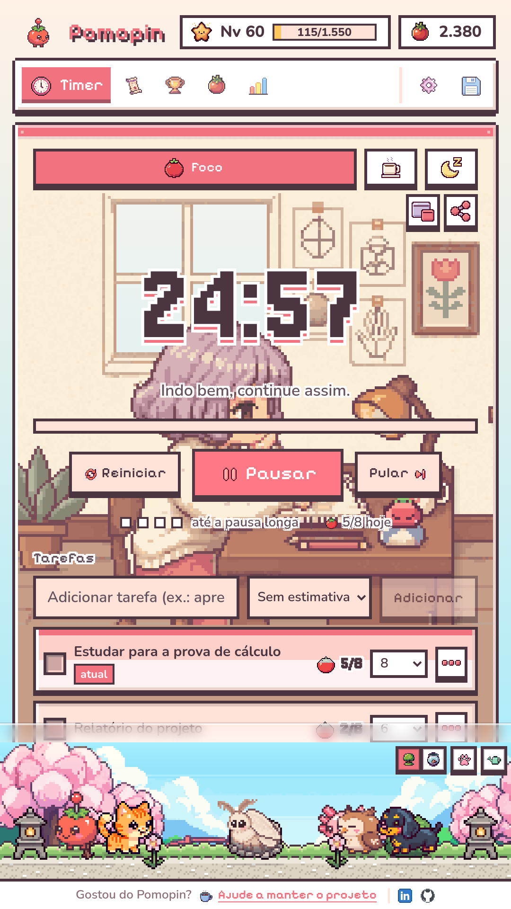
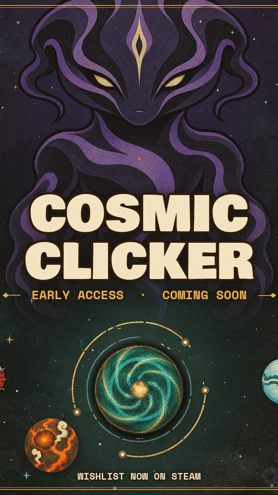
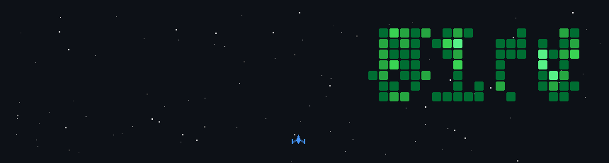

<!-- Banner -->

  

  

  
  
  

  🇧🇷 Português · <a href="README.en.md">🇺🇸 English</a>

---

## 👋 Sobre mim

Sou engenheiro de software e trabalho com **Go** e **AWS** no dia a dia. Nas horas vagas, desenvolvo e publico projetos pessoais e faço freelas.

---

## 💼 Experiências

- 🏦 **Itaú Unibanco**: desenvolvimento backend em **Go** e **AWS** para sistemas críticos, com altíssimo volume de requisições e exigência máxima de disponibilidade, performance e segurança.
- 🚀 **Onze**: implementações customizadas para empresas aderentes à previdência privada, com APIs em Go, DynamoDB, Redis, MySQL, Terraform e serviços AWS (SQS, SNS, S3, Lambda, EKS, ECS).
- 🧱 **Grupo FCamara**: criação de um serviço de assinaturas integrado ao SAP, com .NET Core, Azure Functions e SQL Server.

---

## 🛠️ Projetos em destaque

<table>
  <tr>
    <td width="50%" valign="top">
      
      <h3> Pomopin</h3>
      
<b>Um timer Pomodoro em pixel art, com bichinhos que te acompanham no seu foco.</b>

      <ul>
        <li>⏱️ Foco, pausa curta e pausa longa configuráveis</li>
        <li>🐱 Companheiros que vivem num habitat e reagem ao seu progresso</li>
        <li>🍅 Ganhe tomates e XP e gaste na lojinha</li>
        <li>🏆 Missões diárias e semanais, conquistas e níveis</li>
        <li>📊 Estatísticas de foco por dia e semana</li>
        <li>📲 PWA instalável e offline, sem cadastro</li>
        <li>🌍 8 idiomas</li>      </ul>
      

        
      

    </td>
    <td width="50%" valign="top">
      
      <h3>🌌 Cosmic Clicker</h3>
      
<b>Um incremental sci-fi colorido: construa um império de energia cósmica.</b>

      <ul>
        <li>⚡ Clique, automatize a produção e libere tecnologias</li>
        <li>🪐 Explore planetas e mande expedições</li>
        <li>🔮 Colecione artefatos, buffs e eventos cósmicos</li>
        <li>🐾 Crie pets cósmicos e corra com tardígrados</li>
        <li>✨ Ascenda e gaste Fragmentos de Energia Escura em upgrades permanentes</li>
        <li>🏅 Conquistas, estatísticas e Steam Cloud</li>
        <li>🌍 8 idiomas</li>
      </ul>
      

        
      

    </td>
  </tr>
</table>

---

## 🧰 Stack

   
   
   
  

  
  

---

## 📈 Estatísticas

  

  

  

<!-- Rodapé -->

  

